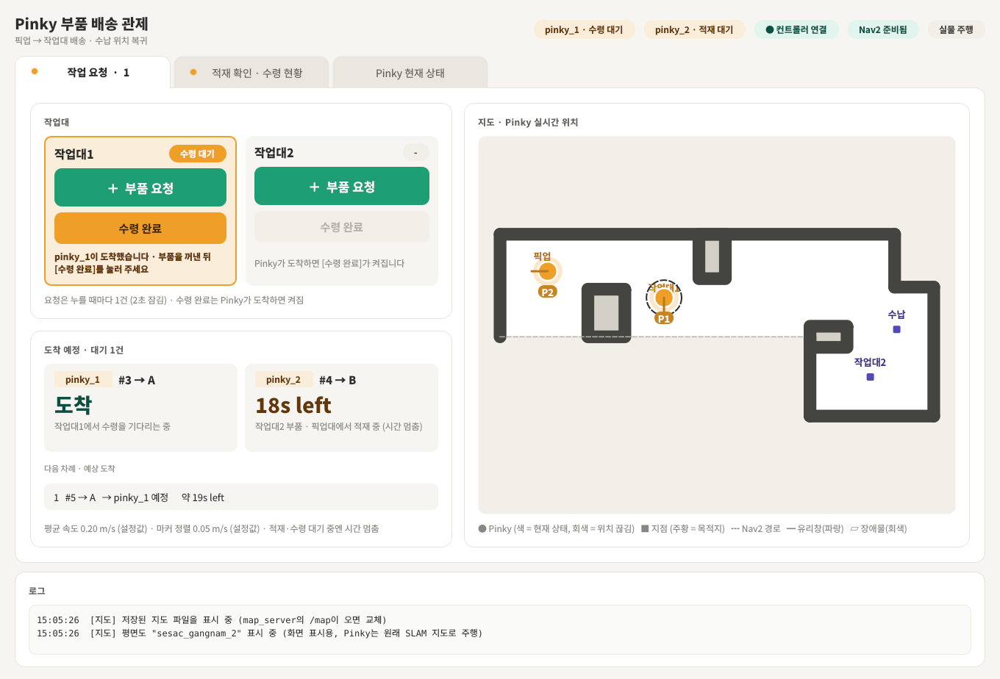
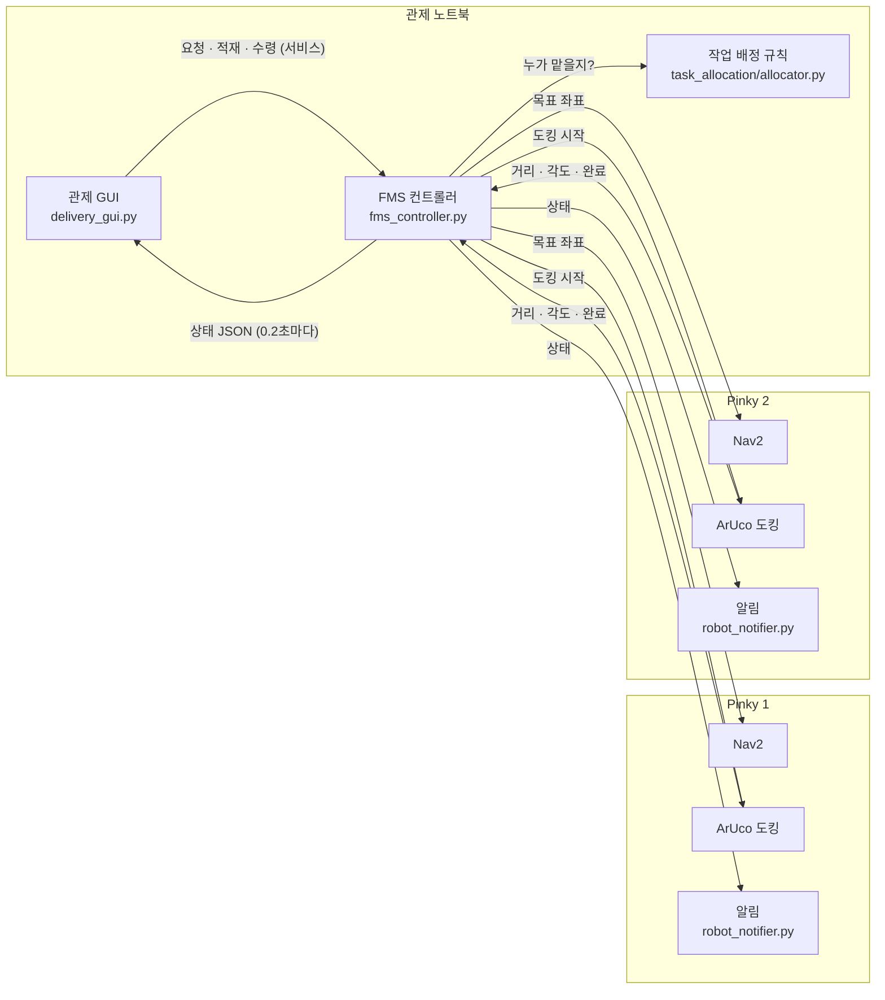
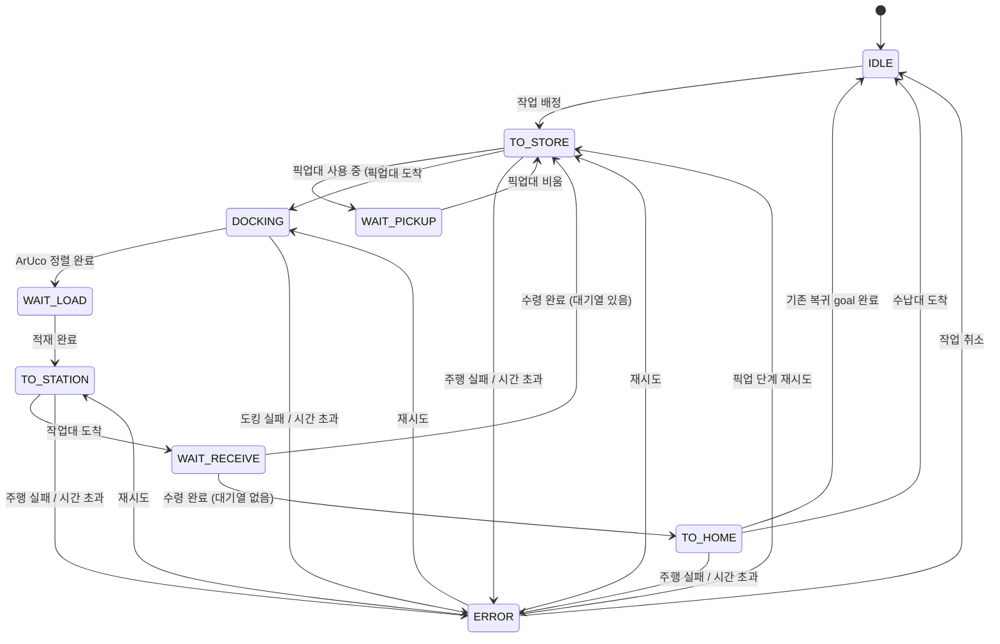
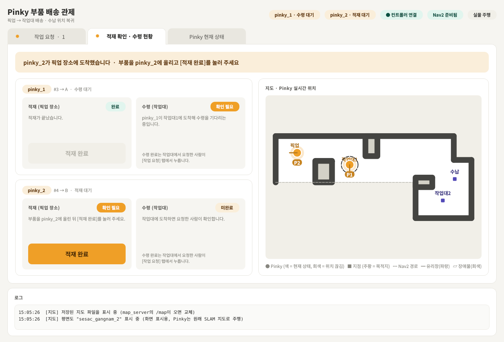
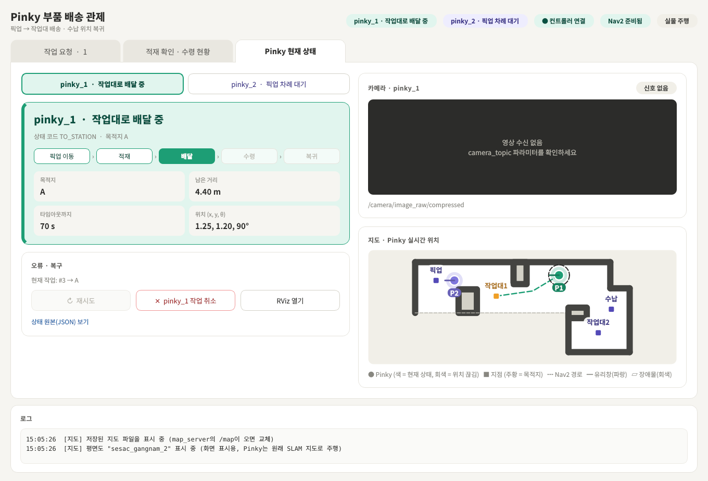

# Pinky 부품 배송 FMS

작업대에서 부품을 요청하면 Pinky Pro 로봇 2대가 픽업대에서 부품을 싣고 작업대까지 가져다주는 **소형 부품 공급 FMS(Fleet Management System)** 입니다.
ROS2 Jazzy + Nav2 기반이며, 3명이 3일 동안 진행한 팀 프로젝트입니다.

<p align="center">
  
</p>

## 무엇을 하나

1. 작업자가 **작업대**에서 [부품 요청]을 누릅니다.
2. FMS가 비어 있는 Pinky 중 가장 알맞은 로봇에 작업을 배정합니다.
3. Pinky가 **픽업대**로 가서 ArUco 마커를 보고 정확히 정렬해 섭니다.
4. 픽업대 담당자가 부품을 싣고 [적재 완료]를 누릅니다.
5. Pinky가 **작업대**로 배달하고, 요청한 작업자가 부품을 꺼낸 뒤 [수령 완료]를 누릅니다.
6. 다음 요청이 있으면 이어서 처리하고, 없으면 **수납대**로 돌아갑니다.

로봇이 사람을 기다리는 동안(적재·수령)에는 로봇 스피커로 알림음이 나오고, 주행 중 앞에 사람이나 물체가 가까이 오면 경고음이 울립니다.

## 팀 구성과 역할

| 역할 | 담당 내용 |
|---|---|
| **ArUco 주차 (도킹)** | 픽업대 앞 마커 인식, 거리·각도 계산, 정밀 정렬 주행, 도킹 완료 판단 |
| **Cost 기반 작업 배정** | 요청을 어느 Pinky에 줄지(거리·대기 시간 cost), 대기열 우선순위, 픽업대·수납대 사용 순서 |
| **이벤트 제어** | 로봇 상태 머신, 사람 입력(요청·적재·수령), 알림(소리·팝업), 오류·복구, 관제 GUI, 도착 시간 예측 |

## 시스템 구성



- 판단은 **FMS 컨트롤러 한 곳**에서만 합니다. GUI는 사람 입력을 전달하고 상태를 그리기만 하므로, GUI를 여러 대 켜도 화면이 어긋나지 않습니다.
- 로봇마다 Nav2를 namespace(`/pinky_1`, `/pinky_2`)로 띄워 토픽을 구분합니다.

## 로봇 상태 머신 (FSM)

로봇마다 아래 FSM이 하나씩 돌고, FMS 컨트롤러가 그 위에서 작업 배정과 픽업대 순서를 정합니다.



- 재시도는 실패했던 이동을 같은 목적지로 다시 보냅니다.
- `WAIT_PICKUP`은 2대일 때, `DOCKING`은 ArUco 도킹을 켰을 때(`docking:=true`)만 생깁니다. 도킹을 끄면 픽업대 도착 즉시 `WAIT_LOAD`입니다.
- 작업 취소는 현재 작업만 버리고, 대기열에 남은 요청은 그대로 처리합니다.

| 상태 | 의미 | 로봇 알림 |
|---|---|---|
| `IDLE` | 수납대에서 대기 | - |
| `TO_STORE` | 픽업대로 이동 | 전방 근접 경고음 |
| `DOCKING` | 픽업대 앞에서 ArUco 마커로 정렬 | - |
| `WAIT_PICKUP` | 다른 Pinky가 픽업대를 쓰는 중이라 그 자리에서 차례 대기 | - |
| `WAIT_LOAD` | 픽업대에서 적재 대기 | 알림음 |
| `TO_STATION` | 작업대로 배달 | 전방 근접 경고음 |
| `WAIT_RECEIVE` | 작업대에서 수령 대기 | 알림음 |
| `TO_HOME` | 수납대로 복귀 | 전방 근접 경고음 |
| `ERROR` | 그 로봇만 멈춤, 다른 로봇은 계속 동작 | - |

## 운영 규칙

| 항목 | 규칙 |
|---|---|
| 지점 | 모두 고정 좌표: 픽업대 `STORE`, 작업대1 `A`, 작업대2 `B`, 수납대 `HOME` |
| 작업 배정 | 공용 대기열 하나. 비어 있는(대기 중이거나 수납대로 복귀 중인) Pinky 중 cost가 가장 낮은 로봇이 맡음 (`task_allocation/allocator.py`) |
| 픽업대 | 한 번에 한 대. 출발할 때 점유하고 적재 완료로 떠날 때 풂. 차 있으면 다른 Pinky는 그 자리에서 대기 (`WAIT_PICKUP`) |
| 수납대 | 1곳을 두 Pinky가 공유. 안에서 자리를 2개로 나눠 주차 (두 번째 자리는 0.35 m 옆) |
| 사람 확인 | 적재 완료는 픽업대 담당자, 수령 완료는 요청한 작업자가 작업대에서 누름 |
| 오류 | 주행·도킹 실패, 시간 초과 시 그 로봇만 `ERROR`. 다른 로봇은 계속 동작. GUI에서 재시도 또는 작업 취소 |

## 관제 GUI

탭 3개로 나뉩니다. 사용 위치에 따라 필요한 탭만 띄워 두면 됩니다.

| 탭 | 사용자 | 기능 |
|---|---|---|
| ① 작업 요청 | 작업대 작업자 | 작업대별 [부품 요청]·[수령 완료], 로봇별 도착 예상 시간, 대기열과 담당 로봇 예상 |
| ② 적재 확인 · 수령 현황 | 픽업대 담당자 | 로봇별 [적재 완료], 새 요청 팝업("pinky_2에 적재해 주세요") |
| ③ Pinky 현재 상태 | 관리자 | 로봇 선택 → 상태·진행 단계·위치·카메라, 재시도/취소 |

<p align="center">
  
  
</p>

- **실시간 지도:** 두 로봇의 위치(TF / AMCL)와 Nav2 경로를 실습실 평면도 위에 표시합니다.
- **도착 시간 예측:** Nav2 남은 거리 + ArUco 정렬 시간 + 픽업대 대기 시간으로 계산하고, 주행할 때마다 실제 속도로 보정합니다. 사람이 싣고 꺼내는 동안에는 숫자가 멈춥니다.
- **오클릭 방지:** 요청 버튼은 누른 뒤 2초 동안 잠기고, 확인 버튼은 해당 상태일 때만 켜집니다.

## 파일 및 폴더 구조

현재 실행 코드와 테스트는 `event_control/`에 모여 있습니다.
공통 설정·launch·별도 테스트 폴더는 향후 분리를 위한 기본 구조입니다.

```text
.
├── README.md
├── event_control/
│   ├── README.md          # 실행법과 실제 팀 인터페이스
│   ├── fms_controller.py  # 2대용 FMS 컨트롤러 (실주행 모드)
│   ├── fms_sim.py         # 같은 컨트롤러의 모의 실행 진입점
│   ├── task_allocation.py # 외부 배정 모듈 연결 및 기본 규칙
│   ├── parts_delivery.py  # 1대 시험용 컨트롤러
│   ├── delivery_gui.py    # 관제 GUI
│   ├── robot_notifier.py  # 로봇 알림
│   ├── maps/              # 지도 YAML·PGM·표시용 평면도
│   ├── sounds/            # 알림음
│   └── test_*.py          # ROS 모의 테스트
├── aruco_docking/         # 도킹 노드 추가 예정
├── task_allocation/
│   ├── README.md          # Cost 식과 Allocator 연결 계약
│   └── allocator.py       # 거리·대기 시간 Cost 배정 클래스
├── config/                # 공통 설정 분리 예정
├── launch/                # ROS2 통합 실행 파일 추가 예정
├── tests/                 # 테스트 분리용 안내 (현재 테스트는 event_control/)
└── docs/
    ├── interfaces.md      # 실제 인터페이스 문서 안내
    └── images/            # GUI 화면 캡처
```

배정 담당자는 `task_allocation/allocator.py`의 `Allocator` 클래스에서 Cost 식과 `dispatch()`, `next_for()`를 수정합니다.
기본 가중치는 거리 0.6·대기 시간 0.4이며, 픽업대 순서는 연결부의 기본 대기 순서를 사용합니다.
FMS는 `event_control/task_allocation.py` 연결부를 통해 호출하며, 모듈 로딩·실행 오류나 잘못된 반환값에는 기본 규칙을 사용합니다.
ArUco 도킹 노드는 아직 포함되지 않았으며, 시작 서비스와 피드백 토픽으로 연결합니다.
실제 모듈 간 약속은 [이벤트 제어 README의 팀 인터페이스](event_control/README.md#팀-인터페이스-이것만-지키면-각자-수정해도-연동됨)를 기준으로 합니다.

## 실행

아래 명령은 저장소의 `event_control/` 폴더에서 실행합니다.

환경: Ubuntu 24.04, ROS2 Jazzy, Nav2, Python 3, PyQt5 또는 PyQt6

```bash
# 각 Pinky: bringup + Nav2(지도 maps/sesac_gangnam_2.yaml) 실행 후, 알림 노드
python3 robot_notifier.py --ros-args -p robot_name:=pinky_1   # 두 번째 로봇은 pinky_2

# 관제 노트북 (로봇과 같은 ROS_DOMAIN_ID)
python3 fms_sim.py                                      # 모의 실행 (로봇이 움직이지 않음)
python3 fms_controller.py --ros-args \
    -p points_file:=/absolute/path/to/measured_points.json \
    -p home_slots_file:=/absolute/path/to/measured_home_slots.json
# 기본은 실주행 모드이며 좌표 파일 필수. 별도 /delivery/arm 전까지 출발하지 않음
PINKY_QT=6 python3 delivery_gui.py                      # PyQt6 사용 시
```

로봇 없이 확인하려면 `python3 test_fms.py fms_controller.py`, `QT_QPA_PLATFORM=offscreen python3 test_gui.py delivery_gui.py`를 실행합니다.
자세한 설정과 문제 해결은 [`event_control/README.md`](event_control/README.md)를 보세요.

## 진행 상황

| 항목 | 상태 |
|---|---|
| 2대 FMS 컨트롤러 (로봇별 상태 머신, 픽업대·작업대 점유, 정지 확인, 오류 격리) | 로직 테스트 완료 · 실차 미검증 |
| Cost 기반 작업 배정 (거리·대기 시간, 수령 후 다음 작업 연결) | 구현 · 모의 테스트 검증, 실차 미검증 |
| 관제 GUI (1대·2대, 도착 시간 예측, 실시간 지도) | 완료 |
| 로봇 알림음 · 전방 근접 경고음 | 완료 |
| ArUco 도킹 노드 (컨트롤러 연결부는 완료) | 진행 중 |
| 실제 로봇 2대 통합 시험 | 예정 |

## 한계와 확장 방향

- 공용 통로 전체를 예약하는 교통 관제는 아직 없습니다. 픽업대·작업대 잠금만으로 두 차의 충돌 회피를 보장할 수 없고, 각 차의 Nav2 장애물 회피도 별도 현장 검증이 필요합니다.
- 실주행에는 측정한 지도 좌표와 두 HOME 주차 위치 파일, 두 차의 독립된 Nav2 action·AMCL 위치 토픽, 두 차의 위치 확인, `/delivery/arm`이 필요합니다. 물리적 비상 정지는 현장 담당자가 사용할 수 있어야 합니다.
- 픽업대 차례를 기다리는 로봇은 그 자리에 멈추므로, 통로 한가운데서 기다릴 수 있습니다.
- 대기열은 컨트롤러 메모리에만 있어 재시작하면 사라집니다.
- 배터리·충전 관리, 고장 난 로봇의 작업을 다른 로봇으로 넘기는 기능은 없습니다.
- 도착 시간에 사람이 싣고 꺼내는 시간은 포함하지 않습니다.

## RViz2 대화형 단일 로봇 미션

기존 2대 FMS와 별도로, 지도에서 직접 지점을 선택해 한 대의 Pinky를 검증하거나 임시 배송 경로를 실행할 수 있는 ROS 2 패키지를 함께 제공합니다. 코드를 중복하지 않도록 FMS는 `event_control/`, 대화형 RViz 임무는 아래 두 패키지로 분리했습니다.

| 패키지 | 노드 | 역할 |
|---|---|---|
| `pinky_mission` | `pinky_mission_manager` (rclpy) | 지점, 경로, Nav2 Action, 안전 검사, 상태와 저장 |
| `pinky_mission_panel` | `pinky_mission_panel_1` (rclcpp) | RViz2 안의 임무 설정·제어·상태 Panel |

RViz `Publish Point`로 지정하는 네 지점은 `1 대기`, `2 픽업`, `3 배송 1`, `4 배송 2`입니다. 여섯 경로는 다음과 같습니다.

1. `1 → 2 → 3 → 1`
2. `1 → 2 → 4 → 1`
3. `1 → 2 → 3 → 4 → 1`
4. `1 → 2 → 4 → 3 → 1`
5. `1 → 2 → 3 → 2 → 4 → 1`
6. `1 → 2 → 4 → 2 → 3 → 1`

빌드와 실행:

```bash
cd ~/dev_ws/ros
source /opt/ros/jazzy/setup.bash
colcon build --packages-select pinky_mission pinky_mission_panel --symlink-install

cd src/pinky_mini
./start_pinky_mission.sh                  # 기본: 주행 차단
ROS_DOMAIN_ID=42 ./start_pinky_mission.sh allow_motion:=true
```

실차 주행은 지도·TF·LaserScan·Costmap·Nav2와 현장 정지 수단을 확인한 뒤에만 허용합니다. 기본값 `allow_motion=false`에서는 지도 클릭이나 시작 버튼이 로봇을 움직이지 않습니다. 자세한 인터페이스와 검증 결과는 [`pinky_mission/README.md`](pinky_mission/README.md), [`pinky_mission/TEST_REPORT.md`](pinky_mission/TEST_REPORT.md)를 확인하세요.

ArUco 역할 매핑은 `66=대기`, `24=픽업`, `87=배송 1`, `42=배송 2`로 저장했습니다. 카메라 보정값, Marker 실측 크기와 고정 자세가 아직 확정되지 않았으므로 ArUco 위치 추정 노드는 포함하지 않습니다.
