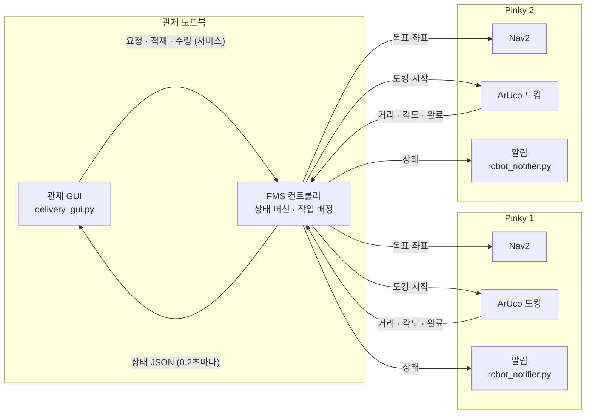
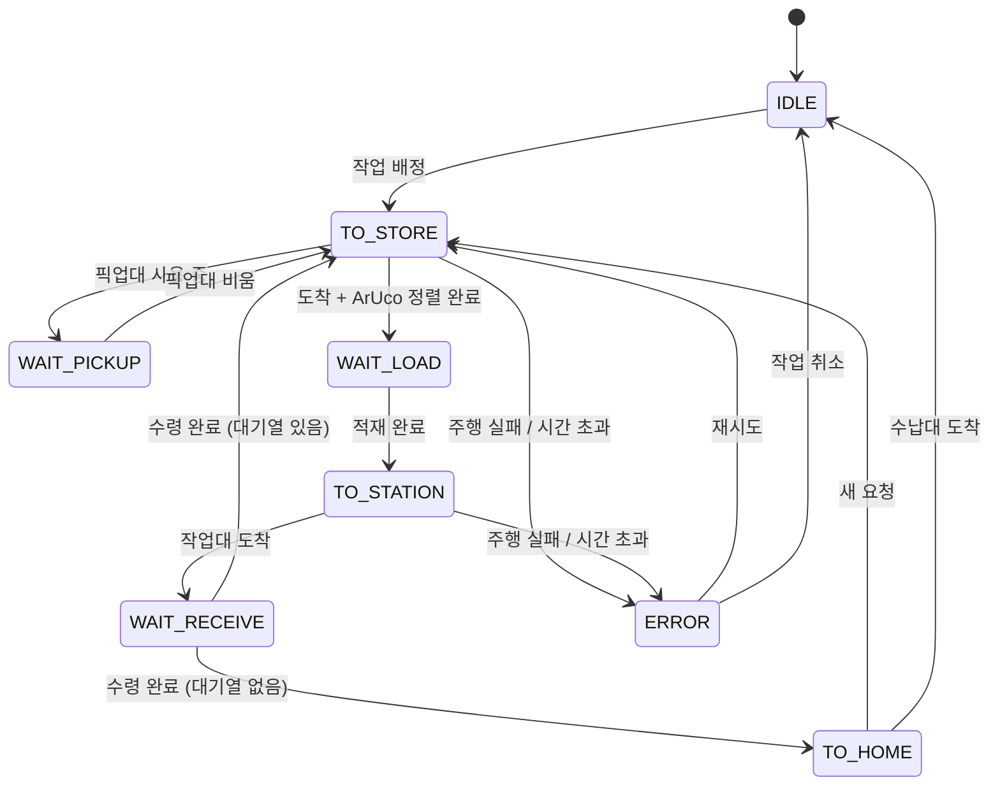

# Pinky 부품 배송 FMS

작업대에서 부품을 요청하면 Pinky Pro 로봇 2대가 픽업대에서 부품을 싣고 작업대까지 가져다주는 **소형 부품 공급 FMS(Fleet Management System)** 입니다.
ROS2 Jazzy + Nav2 기반이며, 3명이 3일 동안 진행한 팀 프로젝트입니다.

<p align="center">
  
</p>

## 무엇을 하나

1. 작업자가 **작업대**에서 [부품 요청]을 누릅니다.
2. FMS가 비어 있는 Pinky 중 가장 알맞은 로봇에 작업을 배정합니다.
3. Pinky가 **픽업대**로 가서 ArUco 마커를 보고 정확히 정렬해 섭니다.
4. 픽업대 담당자가 부품을 싣고 [적재 완료]를 누릅니다.
5. Pinky가 **작업대**로 배달하고, 요청한 작업자가 부품을 꺼낸 뒤 [수령 완료]를 누릅니다.
6. 다음 요청이 있으면 이어서 처리하고, 없으면 **수납대**로 돌아갑니다.

로봇이 사람을 기다리는 동안(적재·수령)에는 로봇 스피커로 알림음이 나오고, 주행 중 앞에 사람이나 물체가 가까이 오면 경고음이 울립니다.

## 팀 구성과 역할

| 역할 | 담당 내용 |
|---|---|
| **ArUco 주차 (도킹)** | 픽업대 앞 마커 인식, 거리·각도 계산, 정밀 정렬 주행, 도킹 완료 판단 |
| **Cost 기반 작업 배정** | 요청을 어느 Pinky에 줄지(거리·대기 시간 cost), 대기열 우선순위, 픽업대·수납대 사용 순서 |
| **이벤트 제어** | 로봇 상태 머신, 사람 입력(요청·적재·수령), 알림(소리·팝업), 오류·복구, 관제 GUI, 도착 시간 예측 |

## 시스템 구성



- 판단은 **FMS 컨트롤러 한 곳**에서만 합니다. GUI는 사람 입력을 전달하고 상태를 그리기만 하므로, GUI를 여러 대 켜도 화면이 어긋나지 않습니다.
- 로봇마다 Nav2를 namespace(`/pinky_1`, `/pinky_2`)로 띄워 토픽을 구분합니다.

## 로봇 상태 머신



| 상태 | 의미 | 로봇 알림 |
|---|---|---|
| `IDLE` | 수납대에서 대기 | - |
| `TO_STORE` | 픽업대로 이동 (도착 후 ArUco 정렬) | 전방 근접 경고음 |
| `WAIT_PICKUP` | 다른 Pinky가 픽업대를 쓰는 중이라 차례 대기 | - |
| `WAIT_LOAD` | 픽업대에서 적재 대기 | 알림음 |
| `TO_STATION` | 작업대로 배달 | 전방 근접 경고음 |
| `WAIT_RECEIVE` | 작업대에서 수령 대기 | 알림음 |
| `TO_HOME` | 수납대로 복귀 | 전방 근접 경고음 |
| `ERROR` | 그 로봇만 멈춤, 다른 로봇은 계속 동작 | - |

## 운영 규칙

| 항목 | 규칙 |
|---|---|
| 지점 | 모두 고정 좌표: 픽업대 `STORE`, 작업대1 `A`, 작업대2 `B`, 수납대 `HOME` |
| 작업 배정 | 공용 대기열 하나. 비어 있는 Pinky 중 cost가 가장 낮은 로봇이 맡음 |
| 픽업대 | 한 번에 한 대. 겹치면 늦게 온 Pinky가 대기 (`WAIT_PICKUP`) |
| 수납대 | 1곳을 두 Pinky가 공유 |
| 사람 확인 | 적재 완료는 픽업대 담당자, 수령 완료는 요청한 작업자가 작업대에서 누름 |
| 오류 | 주행 실패·시간 초과 시 그 로봇만 `ERROR`. GUI에서 재시도 또는 작업 취소 |

## 관제 GUI

탭 3개로 나뉩니다. 사용 위치에 따라 필요한 탭만 띄워 두면 됩니다.

| 탭 | 사용자 | 기능 |
|---|---|---|
| ① 작업 요청 | 작업대 작업자 | 작업대별 [부품 요청]·[수령 완료], 로봇별 도착 예상 시간, 대기열과 담당 로봇 예상 |
| ② 적재 확인 · 수령 현황 | 픽업대 담당자 | 로봇별 [적재 완료], 새 요청 팝업("pinky_2에 적재해 주세요") |
| ③ Pinky 현재 상태 | 관리자 | 로봇 선택 → 상태·진행 단계·위치·카메라, 재시도/취소 |

<p align="center">
  
  
</p>

- **실시간 지도:** 두 로봇의 위치(TF / AMCL)와 Nav2 경로를 실습실 평면도 위에 표시합니다.
- **도착 시간 예측:** Nav2 남은 거리 + ArUco 정렬 시간 + 픽업대 대기 시간으로 계산하고, 주행할 때마다 실제 속도로 보정합니다. 사람이 싣고 꺼내는 동안에는 숫자가 멈춥니다.
- **오클릭 방지:** 요청 버튼은 누른 뒤 2초 동안 잠기고, 확인 버튼은 해당 상태일 때만 켜집니다.

## 파일 및 폴더 구조

현재 저장소에는 아래 기본 폴더와 안내 문서가 준비되어 있습니다.
실행 코드와 ROS2 패키지 설정은 각 담당자가 추가할 예정입니다.
아래 진행 상황 표는 제공된 프로젝트 문서 기준이며, 저장소 업로드 현황과는 별개입니다.

```
.
├── README.md
├── event_control/         # FMS 상태 머신, GUI, 로봇 알림
│   ├── README.md
│   ├── maps/              # GUI 표시용 지도
│   └── sounds/            # 알림음
├── aruco_docking/         # 마커 인식, 정밀 정렬, 도킹
├── task_allocation/       # Cost 계산, 작업 배정, 대기열
├── config/                # 지점 좌표, 로봇 이름, 공통 파라미터
├── launch/                # ROS2 통합 실행 파일 (추가 예정)
├── tests/                 # 단위·통합 테스트 (추가 예정)
└── docs/
    ├── interfaces.md      # 팀 인터페이스 초안
    └── images/            # README 화면 캡처
```

모듈 사이 약속은 [팀 인터페이스 초안](docs/interfaces.md)에 정리합니다.
토픽·서비스·메시지 형식은 팀에서 합의한 뒤 확정합니다.

## 배포 방법

이 프로젝트는 관제 노트북과 Pinky 로봇 2대에 코드를 설치해 실행합니다.
GitHub는 코드 공유와 버전 관리에 사용하며, GitHub Pages 같은 웹 호스팅은 필요하지 않습니다.
현재 저장소에는 기본 구조와 문서만 있어 실제 배포는 실행 코드와 설정을 추가한 뒤 가능합니다.

### 장비별 실행 위치

| 장비 | 실행할 구성 요소 |
|---|---|
| 관제 노트북 | `event_control/`의 FMS·GUI, `task_allocation/`의 작업 배정 |
| Pinky 1 | 기존 로봇 bringup·Nav2, `aruco_docking/`의 도킹, `event_control/`의 알림 노드 |
| Pinky 2 | Pinky 1과 동일한 구성, 로봇 이름과 namespace는 `pinky_2` 사용 |

### 배포 순서

1. 각 장비에 필요한 ROS2 Jazzy 의존성을 준비합니다. 관제 노트북에는 GUI 의존성도 설치합니다.
2. 각 장비에서 저장소를 복제합니다. 비공개 저장소라면 해당 장비에서 GitHub 인증을 먼저 설정합니다.

   ```bash
   git clone https://github.com/brianpark1223/pinky_mini.git
   cd pinky_mini
   ```

3. 같은 네트워크에서 ROS2 통신이 가능한지 확인하고, 세 장비의 `ROS_DOMAIN_ID`를 맞춥니다. 로봇별 namespace, 실제 지도와 지점 좌표, 카메라 보정값도 설정합니다.
4. 코드 추가 후 모의 실행과 테스트를 먼저 수행합니다. 이어서 로봇 한 대를 확인하고, 두 대 통합 시험을 진행합니다.
5. 검증한 커밋이나 릴리스 태그를 세 장비에 동일하게 적용합니다. 업데이트 전에는 실행 중인 노드를 종료합니다.

현재 `package.xml`, `setup.py`, 실행 가능한 launch 파일은 없습니다.
ROS2 패키지 구성이 갖춰진 뒤 `colcon build`와 `ros2 launch`를 사용하는 설치·실행 절차를 확정합니다.
자동 시작 설정은 수동 실행과 로봇 통합 시험을 마친 뒤 추가합니다.

## 실행

> 아래 명령은 실행 코드가 추가된 뒤 사용할 예시입니다. 현재는 해당 파일과 테스트가 없어 실행할 수 없습니다.
> Python 파일 실행 예시는 저장소의 `event_control/` 폴더 안에서 실행하는 기준입니다.

환경: Ubuntu 24.04, ROS2 Jazzy, Nav2, Python 3, PyQt5 또는 PyQt6

```bash
# 각 Pinky: bringup + Nav2(지도 sesac_gangnam) 실행 후, 알림 노드
python3 robot_notifier.py --ros-args -p robot_name:=pinky_1   # 두 번째 로봇은 pinky_2

# 관제 노트북 (로봇과 같은 ROS_DOMAIN_ID)
python3 parts_delivery.py                               # 모의 실행 (로봇이 움직이지 않음)
python3 parts_delivery.py --ros-args -p dry_run:=false  # 실제 주행
PINKY_QT=6 python3 delivery_gui.py                      # PyQt6 사용 시
```

로봇 없이 확인하려면 `python3 test_fsm.py parts_delivery.py`, `QT_QPA_PLATFORM=offscreen python3 test_gui.py delivery_gui.py`를 실행합니다.
자세한 설정과 문제 해결은 [`event_control/README.md`](event_control/README.md)를 보세요.

## 진행 상황

| 항목 | 상태 |
|---|---|
| 1대 FMS 컨트롤러 (상태 머신, Nav2 연동, 오류 복구) | 완료 |
| 관제 GUI (1대·2대, 도착 시간 예측, 실시간 지도) | 완료 |
| 로봇 알림음 · 전방 근접 경고음 | 완료 |
| ArUco 도킹 | 진행 중 |
| Cost 기반 2대 작업 배정 컨트롤러 | 진행 중 |
| 실제 로봇 2대 통합 시험 | 예정 |

## 한계와 확장 방향

- 통로 교통 관제는 없고, 로봇끼리 마주치면 각자의 Nav2 장애물 회피에 맡깁니다.
- 대기열은 컨트롤러 메모리에만 있어 재시작하면 사라집니다.
- 배터리·충전 관리, 고장 난 로봇의 작업을 다른 로봇으로 넘기는 기능은 없습니다.
- 도착 시간에 사람이 싣고 꺼내는 시간은 포함하지 않습니다.
