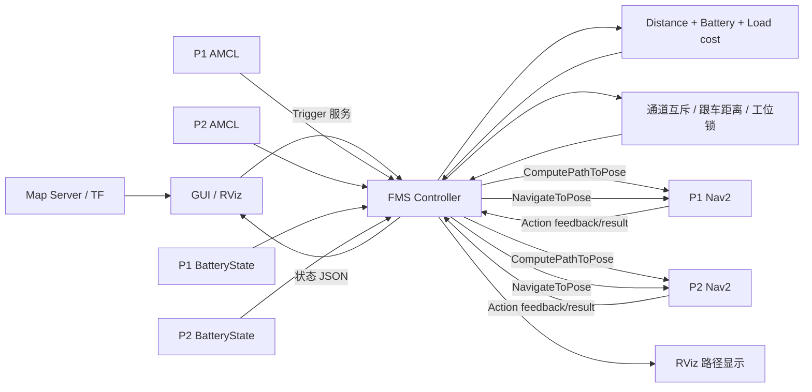

# 双车系统集成状态（2026-11-11）

## 已实现的数据流



## 实际环境检查结果

- ROS 2 Jazzy，`ROS_DOMAIN_ID=42`，地图服务器 active，当前地图为 `sesac_gangnam_2.yaml`。
- 检查时 `/pinky_1/amcl_pose`、`/pinky_2/amcl_pose`、两车 Nav2 action server 和 map 到机器人 TF 均不存在，因此不能进行实车导航测试。
- 用户确认 Pinky-1 地址为 `192.168.14.91`、Pinky-2 地址为 `192.168.14.90`。`scripts/check_system.sh` 默认检查这两个地址，也可用 `PINKY1_HOST` / `PINKY2_HOST` 覆盖。当前工作环境无法访问机器人网络，因此本次没有重新验证 ping、SSH 或 ROS 状态；地址归属以用户提供的信息为准。
- 所有测试都未发送实体机器人运动命令。

## Cost 数据

- 距离优先调用每车 `/<robot>/compute_path_to_pose`，对返回的 `nav_msgs/Path` 全部线段求和。
- Planner 缺失、拒绝或超时时，状态明确标记 `euclidean` 并使用实时 AMCL 位置到 STORE 的欧氏距离。
- 电量订阅每车 `/<robot>/battery_state` 的 `sensor_msgs/msg/BatteryState.percentage`；NaN、越界、缺失和超时都不会伪装为有效电量。
- 实车默认必须有新鲜电量，低于 20% 不接新任务，低于 8% 且正在运行会请求取消 Nav2。阈值均可配置。
- 现有 Cost allocator 的等待时间与连续派单模型被保留；空闲车的距离输入已替换为
  Nav2 路径距离，电量改为真实 BatteryState。默认归一化权重为距离 0.6、等待 0.2、
  电量 0.2，均可通过 FMS 参数修改。

## 交通管理

- A/B 工作台、STORE 和两个 HOME 位已有独占/间距检查。
- 公共通道采用 fail-closed 预约：反向互斥；同向默认也互斥，可在实测安全距离后显式打开跟车。
- 实车配置必须给出通道轴、进入/离开门控航点。进入航向限制为 0–90°（默认 45°），离开为 90–180°（默认 135°）。FMS 先发送门控航点，再发送最终目标，并在两段之间持续持锁。
- 心跳失效时不自动释放锁；取消或异常时锁保持，必须 disarm、现场确认已停止后调用 `traffic_clear`。
- 该逻辑是调度层保护，不能替代 Nav2 costmap、底盘防撞或物理急停。

## 启动

当前工作空间另有两份旧的同名 ROS 包，直接从根目录运行普通 `colcon build` 会报告
duplicate package。项目构建脚本通过 `--base-paths src/pinky_mini` 限定权威来源，不删除旧目录：

```bash
cd /home/zxy/dev_ws/ros
./src/pinky_mini/scripts/build_project.sh
```

安全 dry-run（不会给实体 Nav2 发目标）：

```bash
cd /home/zxy/dev_ws/ros/src/pinky_mini
ROS_DOMAIN_ID=42 ./scripts/start_main_server.sh
```

实车模式要求三个现场实测文件，启动后仍为未解锁状态：

```bash
ROS_DOMAIN_ID=42 ./scripts/start_main_server.sh --real \
  --points /absolute/measured_points.json \
  --home-slots /absolute/measured_home_slots.json \
  --traffic /absolute/measured_traffic.json
```

只有两车 AMCL、电量、Nav2、TF、公共地图和现场急停都验证后，才能调用 `/delivery/arm`。
