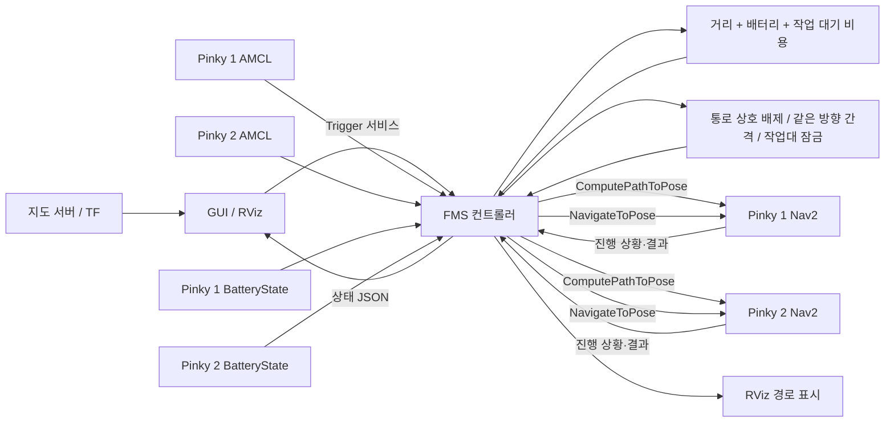

# 두 로봇 시스템 통합 현황 (2026-11-11)

## 구현된 데이터 흐름



## 환경 확인 범위

- 프로젝트는 ROS 2 Jazzy와 `ROS_DOMAIN_ID=42`를 대상으로 구성되어 있습니다.
- 검사 시 `/pinky_1/amcl_pose`, `/pinky_2/amcl_pose`, 두 로봇의 Nav2 액션 서버와 `map`에서 로봇으로 이어지는 TF가 확인되지 않아 실차 내비게이션을 검증할 수 없었습니다.
- 사용자가 알려준 Pinky 1 주소는 `192.168.14.91`, Pinky 2 주소는 `192.168.14.90`입니다. `scripts/check_system.sh`는 이 주소를 기본으로 확인하며 `PINKY1_HOST`와 `PINKY2_HOST` 환경 변수로 바꿀 수 있습니다. 이번 검사 환경에서는 로봇 네트워크에 접속하지 못했으므로 ping, SSH, ROS 상태를 확인하지 않았습니다.
- 테스트는 실제 로봇에 이동 목표를 보내지 않았습니다.

## 배정 비용 데이터

- 로봇별 `/<robot>/compute_path_to_pose` 액션을 우선 요청하고, 반환된 `nav_msgs/Path`의 모든 구간 길이를 합산합니다.
- 경로 계산기를 사용할 수 없거나 경로를 받지 못하면 `distance_source=euclidean`으로 표시하고, 최신 AMCL 위치에서 픽업대 STORE까지 직선거리를 사용합니다.
- 로봇별 `/<robot>/battery_state`의 `sensor_msgs/msg/BatteryState.percentage`를 구독합니다. NaN, 범위 밖 값, 누락, 오래된 값은 실제 배터리 값으로 처리하지 않습니다.
- 실차 모드에서는 최신 배터리 데이터가 기본 필수입니다. 20% 미만인 로봇은 새 작업을 받지 않으며, 주행 중 8% 미만이면 Nav2 취소를 요청합니다. 임계값은 FMS 매개변수로 조정할 수 있습니다.
- 기존 배정기의 대기 시간 및 연속 작업 모델을 유지하면서, 유휴 로봇의 픽업대까지 거리와 실제 BatteryState를 비용에 반영합니다. 기본 가중치는 거리 0.6, 대기 0.2, 배터리 0.2입니다.

## 교통 관리

- A/B 작업대, STORE 픽업대, 두 HOME 주차 위치를 점유 및 간격 기준으로 관리합니다.
- 공용 통로 예약은 장애 시 잠금을 유지합니다. 반대 방향 진입은 서로 차단하며, 같은 방향 주행도 기본적으로 동시에 허용하지 않습니다. 현장에서 안전거리를 검증한 경우에만 같은 방향 추종을 켤 수 있습니다.
- 실차 설정에는 통로 축과 진입·진출 경유점이 필요합니다. 기본 진입 방향은 45도(허용 범위 0~90도), 진출 방향은 135도(허용 범위 90~180도)입니다. FMS는 경유점에 도착한 뒤 최종 목표를 보내며, 두 구간 사이에도 통로 예약을 유지합니다.
- 로봇 신호가 끊겨도 점유 잠금을 자동 해제하지 않습니다. 취소나 오류 후 잠금을 해제하려면 FMS를 정지하고 현장에서 로봇 정지를 확인한 뒤 `traffic_clear`를 호출해야 합니다.
- 이 기능은 배차 단계의 통로 관리입니다. Nav2 비용 지도, 로봇의 장애물 회피, 하드웨어 비상 정지를 대체하지 않습니다.

## 빌드와 실행

현재 ROS 작업공간에는 같은 이름의 오래된 패키지 복사본이 있어, 작업공간 루트에서 일반 `colcon build`를 실행하면 패키지 중복 오류가 날 수 있습니다. 빌드 스크립트는 `--base-paths src/pinky_mini`로 이 저장소만 대상으로 빌드하고 기존 파일은 삭제하지 않습니다.

```bash
cd /home/zxy/dev_ws/ros
./src/pinky_mini/scripts/build_project.sh
```

실제 로봇에 목표를 보내지 않는 모의 실행:

```bash
cd /home/zxy/dev_ws/ros/src/pinky_mini
./scripts/start_main_server.sh
```

실차 모드는 현장에서 측정한 지점, HOME 주차 위치, 통로 설정 파일이 필요합니다. 시작 직후에도 FMS는 잠금 상태로 대기합니다.

```bash
./scripts/start_main_server.sh --real \
  --points /절대경로/실측지점.json \
  --home-slots /절대경로/실측주차위치.json \
  --traffic /절대경로/실측통로.json
```

두 로봇의 AMCL, 배터리, Nav2, TF, 공통 지도와 현장 비상 정지 수단을 확인한 후에만 `/delivery/arm`을 호출해야 합니다. 노트북에서 이미 ROS 도메인을 설정했다면 실행할 때 다시 지정할 필요는 없습니다.
